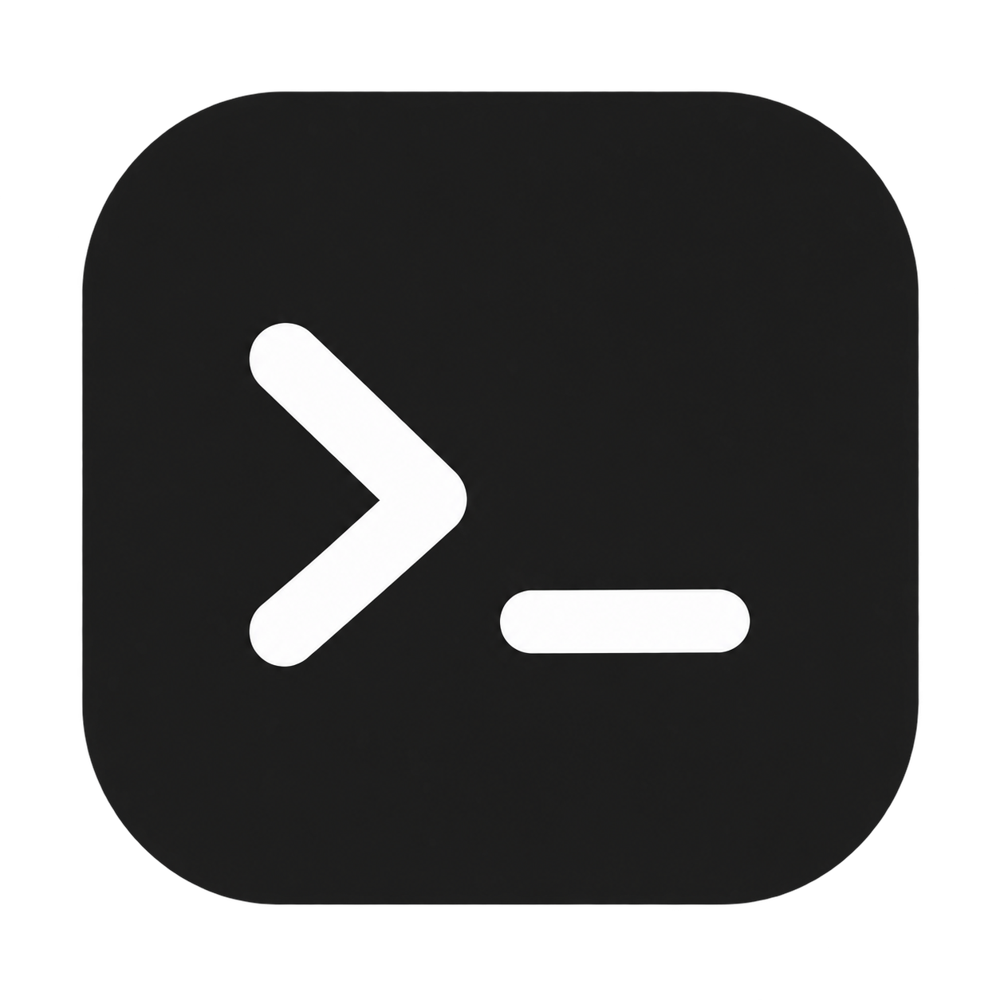
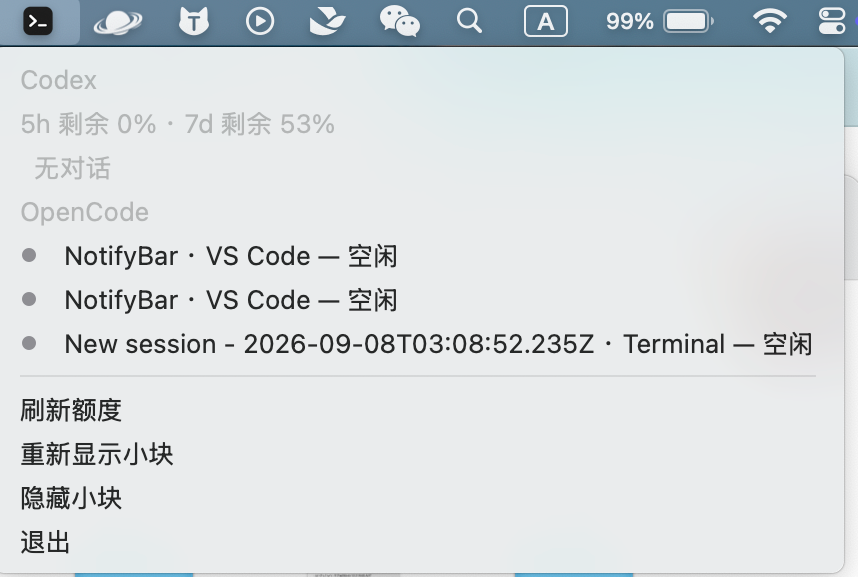

<p align="center"></p>

# NotifyBar

[English](README.md) | 简体中文

一个轻量的 macOS 菜单栏与 Touch Bar 工具，用于查看 Codex 额度、跟踪 Codex / OpenCode 任务，并接收可点击的状态通知。

原生 Swift / AppKit 实现，无第三方运行时依赖。

## 界面截图

### Touch Bar


真实 Touch Bar 截图，展示 Codex 额度及分布在 VS Code、Terminal 中的三个 OpenCode 实例。

### 菜单栏



真实菜单截图，展示对话状态与快捷操作。

## 功能

- **Codex 额度**：显示 5 小时、7 天剩余额度及本地重置时间；百分比由绿到红表示额度充裕程度，每分钟刷新。
- **后台 Touch Bar**：每块 198 × 30 点，切换前台应用后仍可显示；OpenCode 运行时自动加入对应小块。
- **任务列表**：菜单按 Codex / OpenCode 分组显示已检测到的对话、位置与状态；点击打开对应界面。
- **多实例**：OpenCode 按 Terminal / VS Code 分组，每个实例一个状态灯，点击小块轮询切换。
- **通知**：标明来源、对话名称，以及已完成、等待授权、等待回答或已终止；点击通知打开对应界面。

| 状态 | Codex 边框 | OpenCode 状态灯 |
| --- | --- | --- |
| 空闲 | 无色 | 绿色 |
| 处理中 | 蓝色呼吸 | 蓝色呼吸 |
| 等待授权或回答 | 橙色 | 橙色 |
| 完成未读 | 红色 | 红色 |

## 安装与运行

需要 macOS 12 或更新版本。Touch Bar 功能需要配有 Touch Bar 的 Mac；菜单栏与通知也可以独立使用。

源码构建需要 Xcode Command Line Tools：

```sh
xcode-select --install
```

在项目目录执行：

```sh
./build.sh
open build/NotifyBar.app
```

将生成的 `build/NotifyBar.app` 拖到“应用程序”文件夹即可安装。启动后通过菜单栏终端图标操作。需要开机启动时，在 macOS 登录项中添加应用。

Codex 额度需要本机已经安装并登录 Codex / ChatGPT 应用；当前客户端从 `/Applications/ChatGPT.app` 寻找内置 Codex 可执行文件。OpenCode 需要本机安装并正在运行。

## 权限与通知

首次启动时允许系统通知。若希望通知持续停留，请在系统通知设置中将 NotifyBar 的样式设为“提醒”。通知是否呈现还受系统权限和专注模式影响。

跳转 Terminal / VS Code 时可能需要允许自动化；VS Code 集成终端聚焦使用键盘操作，可能需要辅助功能授权。应用不使用麦克风，也没有语音控制功能。

## 实现与当前限制

- Codex 额度通过本机 `codex app-server` 的 `account/rateLimits/read` 获取；不需要填写 API key。
- Codex 状态来自本机 IPC 和未读记录，标题来自本机会话索引。VS Code 跳转参考插件保存的项目归属。
- OpenCode 状态来自本机进程、SQLite 数据库和日志；Terminal 用 TTY 定位标签页，VS Code 用工作目录定位窗口并聚焦终端。
- 读取会话标题、状态和本机存储以展示信息，不主动发送模型请求，也不上传这些数据。
- Touch Bar 后台展示使用 macOS 私有接口，系统或上游应用更新可能需要适配。它管理左侧应用区域，空余空间可放本工具的其他块，不能混入其他应用的 Touch Bar 按钮。
- OpenCode 的进程与会话对应、审批日志判断属于启发式识别；同目录多实例、恢复旧会话及并行子任务可能不准确。VS Code 同窗口多个终端不能保证精确定位到目标标签页。
- Codex / OpenCode 仅在识别到明确的中断标记时报告终止；未提供该标记时无法可靠区分取消与其他结束情况。
- 当前读取已连接、可发现的会话，不是完整历史会话浏览器。打开菜单后状态在下次打开时刷新。
- 构建使用本机架构并进行临时签名，未做 Apple 开发者签名与公证。

## 检查

```sh
./build.sh
build/NotifyBar.app/Contents/MacOS/NotifyBar --self-test
build/NotifyBar.app/Contents/MacOS/NotifyBar --probe
build/NotifyBar.app/Contents/MacOS/NotifyBar --activity-probe
build/NotifyBar.app/Contents/MacOS/NotifyBar --opencode-probe
```

自检覆盖额度解析、颜色、任务状态与跳转分类。探针需要对应本机应用正在运行；自检通过不代表所有终端和上游版本均已验证。

## 许可与致谢

基于 CodexBar 精简并扩展，保留 Jack Chen 与 wjx8 的版权声明。采用 [MIT License](LICENSE)。
